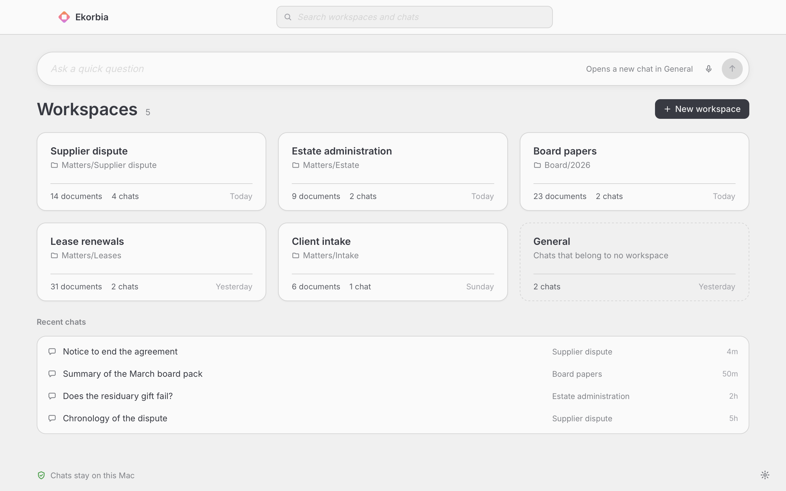

# Ekorbia

[](LICENSE)


Private, local AI for your Mac. Ekorbia runs open models on your own machine with a bundled engine: pick one from the built-in catalog and it downloads. No terminal, no account, no API key. Your chats stay on your Mac.

<p align="center">
  
</p>

## What it does

- **Ask from any app.** ⌘⇧Space opens a quick-question panel over whatever you are doing.
- **Act on copied text.** Copy something, press ⌘⇧E, and summarize, rewrite, fix or explain it.
- **Talk instead of type.** ⌘⇧V dictates from any app, transcribed on your Mac.
- **Ask about your screen.** ⌘⇧1 captures a region into a new chat.
- **Chat with your files.** Attach files or a whole folder; answers cite their sources.
- **Workspaces.** Keep a matter's chats together with its documents, notes, model and templates.
- **Templates.** Reusable instructions kept as plain Markdown files you own; thirteen are included.
- **See what leaves your Mac.** Settings → Privacy lists every connection Ekorbia has made and saves it as a report. An offline lock refuses them all.

Also: save a reply or a whole chat as a Word document, save a file the model wrote in a reply, compare two or three models side by side, private chats that are never saved, search across every chat, summaries of new files in a folder you choose to watch, optional thinking before answers, math in replies, and light and dark looks.

What changed in each release is in the [changelog](CHANGELOG.md). More at [ekorbia.com](https://ekorbia.com).

## Install

1. Download the `.dmg` from the [latest release](https://github.com/ekorbia/ekorbia-desktop/releases/latest).
2. Drag **Ekorbia** into Applications and open it.
3. On first launch Ekorbia looks at your Mac's memory, suggests a model that fits, and downloads it.

You need a Mac with Apple Silicon and macOS 12 or newer. 8 GB of memory runs the small models; 16 GB or more is better. Models take 3 to 19 GB of disk each.

Windows and Linux builds ended with 0.7.1. Those installers remain on the Releases page.

### First launch on macOS (important)

Ekorbia is not signed with an Apple Developer ID, so macOS blocks it the first time. Both messages below have the same cause, a quarantine mark your browser puts on downloads, and a one-time fix.

**"Ekorbia…dmg is damaged and can't be opened."** The file is fine. Remove the mark, then open the `.dmg` again:

```bash
xattr -dr com.apple.quarantine ~/Downloads/Ekorbia_*.dmg
```

**macOS says it could not verify Ekorbia.** Open **System Settings → Privacy & Security**, find the message about Ekorbia and click **Open Anyway**. On macOS 14 or earlier you can instead right-click the app and choose **Open**. Or run:

```bash
xattr -dr com.apple.quarantine /Applications/Ekorbia.app
```

To check a download against the release's checksums, run `shasum -a 256 -c SHA256SUMS.txt` beside it. A [build from source](#build-from-source) needs no bypass.

## Models

The bundled engine is [llama.cpp](https://github.com/ggml-org/llama.cpp). The catalog offers Gemma 4 (E2B, E4B, 12B, 26B and 31B) and Qwen (3.5 4B, 3.5 9B and 3.8 27B). Each catalog model is checked against a pinned checksum when it downloads. Settings → Models offers three that fit your Mac: Fast, Balanced and Most capable. Settings → Advanced has the whole catalog and takes a Hugging Face link, so you can add any GGUF model.

Prefer your own runtime? Settings → Advanced switches to [Ollama](https://ollama.com) or any OpenAI-compatible server, such as LM Studio, llama-server or vLLM.

## Privacy and your data

- No telemetry, no account, and no code or fonts loaded from the internet. Once a model is downloaded, Ekorbia works offline.
- The only network traffic is what you ask for: model downloads from Hugging Face, and a custom endpoint if you set one up. Settings → Privacy shows each connection, and the offline lock stops them.
- Chats are in a SQLite database in `~/Library/Application Support/com.ekorbia.desktop/`, with models in the `models` folder beside it.
- Templates and each workspace's notes are plain Markdown in `~/Documents/Ekorbia/`.
- Closing the window keeps Ekorbia running for its hotkeys and Watches, and ends any private chat. ⌘Q quits.

## Build from source

You need [Rust](https://rustup.rs), the Xcode Command Line Tools (`xcode-select --install`), `cmake` (`brew install cmake`) and the Tauri CLI (`cargo install tauri-cli --version '^2'`).

```bash
git clone https://github.com/ekorbia/ekorbia-desktop.git
cd ekorbia-desktop
./scripts/fetch-llama-server.sh      # build the bundled engine, once
./scripts/dev.sh                     # run the app in development
(cd src-tauri && cargo tauri build)  # or build Ekorbia.app and the .dmg
```

Run the tests with `./scripts/run-all-tests.sh`. The UI suite needs Node 20 or newer, `npm ci` and `npx playwright install webkit`. [CONTRIBUTING.md](CONTRIBUTING.md) lists the test gates and the conventions a patch has to follow.
